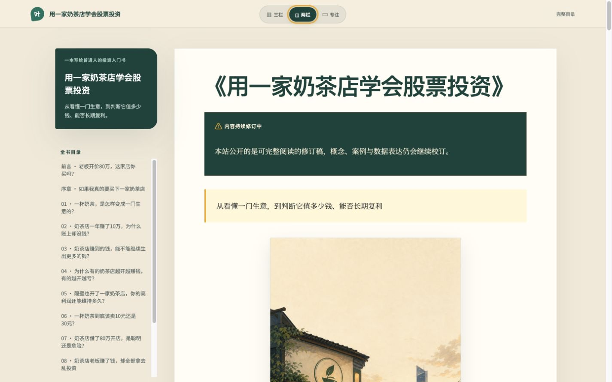
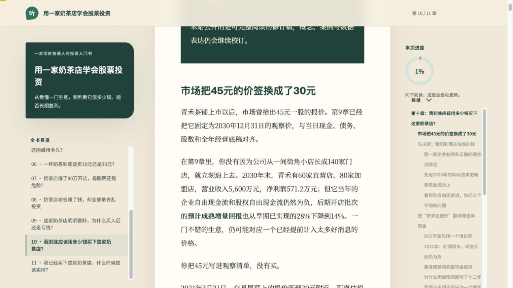
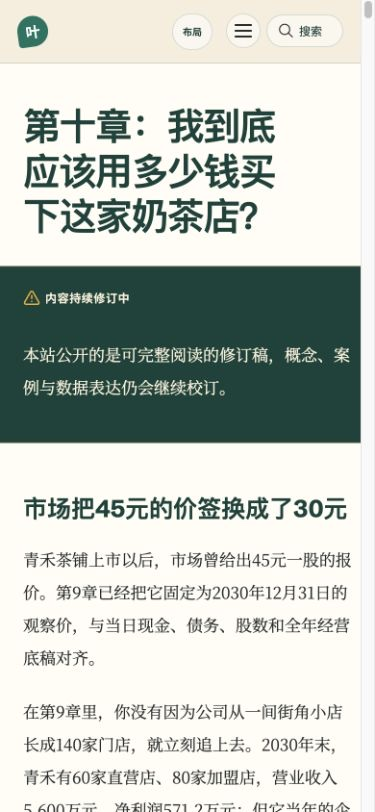

<div align="center">

# 用一家奶茶店学会股票投资

**从看懂一门生意，到判断它值多少钱、能否长期复利**

一本写给普通人的股票投资入门书。全书只用同一家虚构企业——**青禾茶铺**——带你走完理解生意、读懂财务、判断竞争力、估值、买入、持有与卖出的完整过程。

[](https://qinghe.taoweng.site/)
[](https://github.com/crazylxr/qinghe-investing-book/actions/workflows/deploy-pages.yml)
[](https://quartz.jzhao.xyz/)

> 当前公开版本为可完整阅读的修订稿，概念、案例与数据表达仍会继续校订。

</div>

[](https://qinghe.taoweng.site/)

## 这本书在讲什么？

很多投资书从指标、公式或股票代码开始。这本书换了一条更直观的路：假设一家奶茶店老板开价 **80 万元**，问你愿不愿意把它买下来。

要回答这个问题，你必须逐步弄清楚：

- 它靠什么赚钱，一杯奶茶如何变成利润；
- 为什么账面赚了钱，银行卡里却不一定有现金；
- 新开门店是在创造价值，还是只把规模做大；
- 高利润能维持多久，竞争者为什么无法轻易复制；
- 债务、管理层和资本配置会带来什么风险；
- 好公司为什么也可能是一笔糟糕的投资；
- 怎样用现金流估值，并为不确定性留出安全边际；
- 买入以后，什么时候应该继续持有、减仓或卖出。

随着信息一章章增加，你会不断修改对“青禾茶铺”的判断与报价，最后形成一份完整、可复盘的投资分析。

## 适合谁读？

- 想系统学习基本面投资，但不想从一堆术语开始的读者；
- 会看 PE、ROE，却还不能把商业模式、财务质量和估值串起来的人；
- 想建立自己的公司研究、估值和持仓复盘框架的投资者；
- 希望用一个连续案例理解三张财务报表、ROIC、护城河、DCF 与安全边际的学习者。

这不是荐股书，也不是奶茶店并购手册。书中的企业和案例用于教学，不构成任何投资建议。

## 推荐阅读路线

| 阶段               | 要解决的问题                               | 对应章节   |
| ------------------ | ------------------------------------------ | ---------- |
| 建立视角           | 买股票为什么等于买下一门生意的一小部分？   | 前言、序章 |
| 看懂生意与现金     | 企业如何赚钱？利润为什么不等于现金？       | 第 1—2 章  |
| 判断资本回报与增长 | 留存利润能否持续创造更多价值？             | 第 3—4 章  |
| 判断竞争与持续性   | 高利润为什么能够维持？企业是否拥有定价权？ | 第 5—6 章  |
| 识别风险与资本配置 | 债务是否危险？管理层会怎样使用赚到的钱？   | 第 7—8 章  |
| 连接价格与价值     | 好公司为何也会买贵？怎样计算合理价值区间？ | 第 9—10 章 |
| 持有、退出与复盘   | 哪些变化足以推翻最初的投资逻辑？           | 第 11 章   |

如果你是第一次接触基本面投资，建议从前言开始顺序阅读；如果已经具备基础，可以从[第九章：好公司为什么也会买亏](https://qinghe.taoweng.site/chapter-09)或[第十章：怎样估算合理价格](https://qinghe.taoweng.site/chapter-10)开始，再回头补齐前面的分析链条。

## 全书目录

### 前置：先把股票重新看成一门生意

- [前言：老板开价 80 万，这家奶茶店你买吗？](https://qinghe.taoweng.site/preface)
- [序章：如果我真的要买下一家奶茶店](https://qinghe.taoweng.site/chapter-00)

### 第一部分：看懂生意与现金

1. [一杯奶茶，是怎样变成一门生意的？](https://qinghe.taoweng.site/chapter-01)
2. [奶茶店一年赚了 10 万，为什么账上却没钱？](https://qinghe.taoweng.site/chapter-02)

### 第二部分：增长、竞争与资本配置

3. [奶茶店赚到的钱，能不能继续生出更多的钱？](https://qinghe.taoweng.site/chapter-03)
4. [为什么有的奶茶店越开越赚钱，有的越开越亏？](https://qinghe.taoweng.site/chapter-04)
5. [隔壁也开了一家奶茶店，你的高利润还能维持多久？](https://qinghe.taoweng.site/chapter-05)
6. [一杯奶茶到底该卖10元还是30元？](https://qinghe.taoweng.site/chapter-06)
7. [奶茶店借了80万开店，是聪明还是危险？](https://qinghe.taoweng.site/chapter-07)
8. [赚到的钱，该继续开店还是分给股东？](https://qinghe.taoweng.site/chapter-08)

### 第三部分：价格、价值与持有

9. [这家奶茶店明明很好，为什么买入后还是亏钱？](https://qinghe.taoweng.site/chapter-09)
10. [我到底应该用多少钱买下这家奶茶店？](https://qinghe.taoweng.site/chapter-10)
11. [我已经买下这家奶茶店，什么时候应该卖掉？](https://qinghe.taoweng.site/chapter-11)

### 结语与附录

- [结语：从买下一家店，到拥有一家公司的部分未来](https://qinghe.taoweng.site/conclusion)
- [附录A：如果真要买一家奶茶店——实地尽调清单](https://qinghe.taoweng.site/appendix-a)
- [附录B：核心指标与口径速查表](https://qinghe.taoweng.site/appendix-b)
- [附录C：估值工具箱](https://qinghe.taoweng.site/appendix-c)
- [附录D：普通框架失效时怎么办](https://qinghe.taoweng.site/appendix-d)
- [附录E：十年财务分析与投资备忘录模板](https://qinghe.taoweng.site/appendix-e)

本仓库包含可完整阅读的修订稿，共20页（目录、前言、序章、第1—11章、结语及五篇附录），引用20张插图。

## 阅读体验

站点采用纸本阅读风格。桌面端首次访问默认使用「全书目录 + 加宽正文」的两栏布局，也可以切换为三栏或专注阅读；选择会在后续章节中保留。移动端自动收起辅助信息，以单栏正文为主，并保留紧凑的布局与目录入口。

<table>
  <tr>
    <td width="68%" valign="top">
      <a href="https://qinghe.taoweng.site/chapter-10">
        
      </a>
      <p align="center"><sub>桌面端：默认两栏，正文更宽，也可切换三栏或专注阅读</sub></p>
    </td>
    <td width="32%" valign="top">
      <a href="https://qinghe.taoweng.site/chapter-10">
        
      </a>
      <p align="center"><sub>移动端：自动使用单栏正文，目录与布局入口随时可用</sub></p>
    </td>
  </tr>
</table>

目前支持：

- 中文全文搜索；
- 稳定章节链接与上一章 / 下一章导航；
- 三栏、两栏与专注阅读切换，并自动记忆读者选择；
- 阅读进度、章内目录和移动端折叠菜单；
- Obsidian Callout、脚注、表格、LaTeX 公式和插图；
- 响应式排版，适配桌面、平板和手机；
- GitHub Pages 自动构建与发布。

## 一句话推荐

如果你觉得这本书对朋友有帮助，可以直接转发在线地址：

> 《用一家奶茶店学会股票投资》：不用先背财务指标，跟着一家虚构奶茶店，从 80 万元报价开始，一步步学会看生意、看现金流、判断护城河、做估值，并决定什么时候买入、持有或卖出。在线免费阅读：https://qinghe.taoweng.site/

欢迎通过 [Issue](https://github.com/crazylxr/qinghe-investing-book/issues) 提交错别字、断链、概念疑问和阅读建议，也欢迎把项目分享给正在学习基本面投资的朋友。

---

## 技术实现

本站基于 [Quartz 5](https://quartz.jzhao.xyz/) 构建，并针对连续阅读一本书的场景做了定制：

- **内容来源：** Obsidian Markdown；
- **静态站点：** Quartz 5；
- **样式与交互：** SCSS、Preact、自定义 Quartz 插件；
- **搜索：** Quartz 本地全文索引，无需后端服务；
- **构建与托管：** GitHub Actions + GitHub Pages；
- **依赖管理：** npm lockfile 锁定 Quartz 与插件版本。

### 项目结构

```text
.
├── book.manifest.json        # 章节顺序、公开状态、稳定 URL 的唯一站点配置
├── content/                  # 可独立构建、可提交的公开内容快照
│   ├── index.md              # 首页与完整目录
│   ├── preface.md            # 前言
│   ├── chapter-00.md         # 序章
│   ├── chapter-01.md ...     # 第 1—11 章
│   ├── conclusion.md         # 结语
│   ├── appendix-a.md ...     # 附录 A—E
│   └── assets/               # 正文实际引用的公开插图
├── plugins/book-toolbar/     # 书籍导航、进度与移动端工具栏
├── quartz/                   # Quartz 5 核心与站点样式
├── quartz.config.yaml        # 站点、插件、SEO 与主题配置
├── scripts/
│   ├── sync-book.mjs         # 从 Obsidian 书稿生成白名单发布快照
│   └── validate-book.mjs     # 页面、资源、链接和隐私边界验证
└── .github/workflows/        # GitHub Pages 自动部署流程
```

## 本地运行

### 环境要求

- Node.js 22 或更高版本（CI 使用 Node.js 24）；
- npm 10.9.2 或更高版本。

### 安装与预览

```bash
git clone https://github.com/crazylxr/qinghe-investing-book.git
cd qinghe-investing-book

npm ci
npx quartz plugin install --from-config
npm run dev
```

启动后按照终端提示打开本地地址即可预览。仓库中的 `content/` 已经是完整发布快照，只想阅读或调整网站样式时，不需要访问原始 Obsidian 仓库，也不需要先执行内容同步。

### 构建与检查

```bash
npm run check
npm run build
npm run validate:book
```

- `npm run check`：执行 TypeScript 类型检查与 Prettier 格式检查；
- `npm run build`：生成静态站点到 `public/`；
- `npm run validate:book`：检查公开页面、图片、导航、断链及隐私边界。
- `npm run test:book`：验证新增页面导航、评论范围及资源缺失时保留旧快照。
- `node scripts/render-book-figures.mjs --data <重算结果.json> --output <书稿附件目录>`：重制知识图SVG与PNG，保持数字取自模型。

## 从 Obsidian 同步书稿

Obsidian 中的书稿是正文的唯一来源，仓库中的 `content/` 是发布用快照。维护者可以执行：

```bash
npm run sync:book -- --source "/path/to/Obsidian/用一家奶茶店学会股票投资"
```

同步过程由 `book.manifest.json` 白名单控制，只会复制manifest 中标为 published 的公开 Markdown 和这些正文实际引用的图片，并将链接改写为网站可用路径。

以下内容不会进入公开站点：

- 原始资料和数据底稿；
- 案例核验记录；
- 财务模型与 Excel 文件；
- 内部审稿报告、模型导出数据和本地检查证据（`review/`不提交至公开仓库）；
- 其他 Obsidian Vault 内容；
- 本机绝对路径和内部工作链接。

完成同步后，建议依次执行：

```bash
npm run check
npm run build
npm run validate:book
git diff -- content book.manifest.json
```

确认发布快照只包含预期正文与图片，再提交变更。

## 读者讨论

前言、序章和第 1—11 章末尾通过本地插件 `@qinghe/book-comments` 接入博客现有的 Twikoo 服务。
评论范围保持为前言、序章与第 1—11 章；首页、结语和附录不开放评论。表单必填项、审核、邮件通知等配置与博客共用。

- 在 `quartz.config.yaml` 的插件选项中配置 `envId` 和 `pathPrefix`；只需要公开服务地址，不需要数据库凭据。
- 评论以固定章节 ID 分类，例如 `/qinghe-book/chapter-01`。已有留言后，请保持前缀和章节 ID 稳定；修改标题、域名和访问参数不会改变评论归属。
- Twikoo 前端固定为 `1.6.44`，`npm run dev` 和 `npm run build` 会自动构建插件并准备同域静态资源。直接执行 Quartz CLI 前，先运行 `npm run prepare:comments`。
- 评论在滚动接近页面末尾时加载，失败后可以重试。阅读进度只计算正文，不受评论数量影响。
- `npm run test:comments` 验证章节隔离、过期加载清理和阅读进度；`npm run validate:book` 在构建后检查实际页面与资源。
- 构建后运行 `npm run test:comments:browser`，使用已安装的 Google Chrome 验证真实 Twikoo 客户端在表情请求延迟时的切章行为；请求由测试拦截，不写入线上数据。部署工作流也执行这项检查。
- 发布的 Twikoo 静态副本包含一处生命周期修复：表情请求返回后，若原评论框已销毁，则跳过初始化。该补丁只适用于固定的 `1.6.44`；代码结构变化时构建会报错，要求重新核验。
- 停用时将该插件的 `enabled` 改为 `false`，数据库留言仍然保留。升级 Twikoo 前，需要重新验证 Vue 实例清理与快速切章行为。

本地开发和生产环境连接的是同一套评论服务，评论链接固定使用正式章节网址。自动验证只读取评论；真实留言、回复与通知请手动验收，尤其确认通知链接指向实际章节网址。以后添加“最新评论”时，需按书站的章节评论标识筛选，避免汇总博客的留言。

## 部署

`main` 分支每次推送后，GitHub Actions 会自动：

1. 安装锁定版本的依赖与 Quartz 插件；
2. 验证内容快照；
3. 构建生产站点；
4. 再次扫描构建结果；
5. 发布到 GitHub Pages。

工作流状态可以在 [Deploy GitHub Pages](https://github.com/crazylxr/qinghe-investing-book/actions/workflows/deploy-pages.yml) 查看。线上站点始终使用已提交的 `content/` 快照，构建过程不依赖维护者电脑中的 Obsidian 路径。

## 内容边界与说明

- `book.manifest.json` 是网站侧章节顺序、公开状态和稳定 URL 的唯一配置；
- 所有已发布章节统一标记“内容持续修订中”；
- 结语和附录拥有稳定网址与完整导航；页数和图片数量由 manifest 与正文引用推导；
- 书中企业“青禾茶铺”为教学用虚构案例；
- 本书用于投资教育和方法讨论，不构成证券推荐或个性化投资建议；
- 项目授权范围以 [LICENSE.txt](LICENSE.txt) 为准。

## 参与完善

你可以通过 [Issues](https://github.com/crazylxr/qinghe-investing-book/issues) 反馈：

- 错别字、病句或排版问题；
- 页面断链、搜索或移动端显示问题；
- 财务概念、计算口径或案例表达不清楚的地方；
- 希望在结语或附录中补充的主题。

提交内容修正时，请尽量说明章节、原文位置、建议修改内容和理由。原始书稿仍在 Obsidian 中维护，因此合并公开快照的改动前，维护者还需要把修改同步回正文来源。

---

<div align="center">

**先看懂一门生意，再决定要不要成为它的股东。**

[开始阅读](https://qinghe.taoweng.site/) · [完整目录](https://qinghe.taoweng.site/) · [提交反馈](https://github.com/crazylxr/qinghe-investing-book/issues)

</div>
